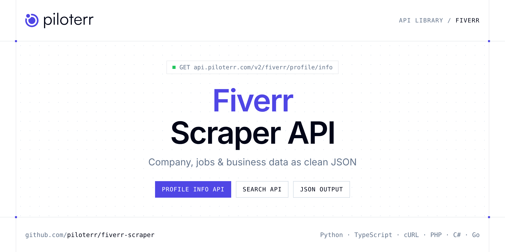

<p align="center">
  <a href="https://www.piloterr.com"></a>
</p>

# Fiverr Scraper API

[](https://discord.gg/CFj3ph8aHU) [](https://app.piloterr.com) [](https://app.piloterr.com/openapi) [](LICENSE)

The **Piloterr Fiverr Scraper API** lets you extract public data from Fiverr as **clean, structured JSON** — no proxies, headless browsers or HTML parsing to maintain. Endpoints available in production:

- **Fiverr Profile Info API** — Extract complete public profile data from any Fiverr seller, including gigs, ratings, reviews, skills, portfolio, and consultation pricing.
- **Fiverr Search API** — Search Fiverr gigs using a direct search URL and receive paginated listings with seller information, gig titles, images, and seller levels.

Use it for lead generation, CRM enrichment, market mapping, investment research or job market analytics.

| Endpoint | Path | Credits | What you get |
|---|---|---|---|
| [Fiverr Profile Info API](#fiverr-profile-info-api) | `/v2/fiverr/profile/info` | 1 | Extract complete public profile data from any Fiverr seller, including gigs, ratings, reviews, skills, portfolio, and consultation pricing. |
| [Fiverr Search API](#fiverr-search-api) | `/v2/fiverr/search` | 1 | Search Fiverr gigs using a direct search URL and receive paginated listings with seller information, gig titles, images, and seller levels. |

## Table of contents

- [How it works](#how-it-works)
- [Fiverr Profile Info API](#fiverr-profile-info-api)
- [Fiverr Search API](#fiverr-search-api)
- [Code examples in other languages](#code-examples-in-other-languages)
- [Practical use cases](#practical-use-cases)
- [Why Piloterr?](#why-piloterr)
- [FAQ](#faq)
- [Related scrapers](#related-scrapers)
- [Support](#support)

## How it works

1. **Create a free Piloterr account** and copy your API key from the [dashboard](https://app.piloterr.com).
2. **Send a `GET` (or `POST`) request** to `https://api.piloterr.com/v2/...` with the header `x-api-key: YOUR_API_KEY`.
3. **Receive structured JSON** — Piloterr handles rendering, proxies, retries and parsing.

```bash
export PILOTERR_API_KEY="your-api-key"
pip install requests        # Python
# TypeScript: Node.js 18+ (native fetch), run with `npx tsx file.ts`
```

> Every endpoint accepts both `GET` (query string) and `POST` (JSON body with the same fields).

## Fiverr Profile Info API

Extract complete public profile data from any Fiverr seller, including gigs, ratings, reviews, skills, portfolio, and consultation pricing.

`GET | POST https://api.piloterr.com/v2/fiverr/profile/info` · **1 credit per request** · [Full reference](https://app.piloterr.com/openapi)

### Request parameters

| Parameter | Type | Required | Description |
|---|---|---|---|
| `query` | string | ✅ | Fiverr profile URL of the seller you want to extract information from. |

### Python example

```python
import json
import os
import requests

response = requests.get(
    "https://api.piloterr.com/v2/fiverr/profile/info",
    headers={"x-api-key": os.environ["PILOTERR_API_KEY"]},
    params={
        "query": "https://www.fiverr.com/username",
    },
    timeout=60,
)
response.raise_for_status()
data = response.json()

print(json.dumps(data, indent=2, ensure_ascii=False)[:2000])
```

### TypeScript example

```typescript
type FiverrProfileInfo = {
  user?: {
    id?: string;
    name?: string;
    address?: {
      country_code?: string;
      country_name?: string;
    };
    profile?: {
      display_name?: string;
    };
    joined_at?: number;
    languages?: {
      code?: string;
      level?: string;
    }[];
    profile_image_url?: string;
    is_activation_completed?: boolean;
  };
  is_pro?: boolean;
  rating?: {
    count?: number;
    score?: number;
  };
  gigs_data?: {
    title?: string;
    gig_id?: number;
    is_pro?: boolean;
    status?: string;
    price_i?: number;
    seller_level?: string;
    seller_rating?: {
      count?: number;
      score?: number;
    };
  }[];
  is_active?: boolean;
  description?: string;
  hourly_rate?: {
    price_in_cents?: number;
  };
  seller_level?: string;
  response_time?: {
    in_hours?: number;
  };
  is_on_vacation?: boolean;
  one_liner_title?: string;
  achievement_level?: string;
  approved_gigs_count?: number;
};

const params = new URLSearchParams({
  "query": "https://www.fiverr.com/username",
});

const response = await fetch(`https://api.piloterr.com/v2/fiverr/profile/info?${params}`, {
  headers: { "x-api-key": process.env.PILOTERR_API_KEY! },
});
if (!response.ok) throw new Error(`Piloterr error ${response.status}: ${await response.text()}`);

const data = (await response.json()) as FiverrProfileInfo;

console.log(JSON.stringify(data, null, 2).slice(0, 2000));
```

<details>
<summary><b>POST variant</b></summary>

```http
POST https://api.piloterr.com/v2/fiverr/profile/info
x-api-key: YOUR_API_KEY
Content-Type: application/json

{"query": "https://www.fiverr.com/username"}
```
</details>

### Output example

Response shape with placeholder values — field names follow the API reference.

```json
{
  "user": {
    "id": "example",
    "name": "example",
    "address": {
      "country_code": "example",
      "country_name": "example"
    },
    "profile": {
      "display_name": "example"
    },
    "joined_at": 0,
    "languages": [
      {}
    ],
    "profile_image_url": "example",
    "is_activation_completed": false
  },
  "is_pro": false,
  "rating": {
    "count": 0,
    "score": 0
  },
  "gigs_data": [
    {
      "title": "example",
      "gig_id": 0,
      "is_pro": false,
      "status": "example",
      "price_i": 0,
      "seller_level": "example",
      "seller_rating": {}
    }
  ],
  "is_active": false,
  "description": "example",
  "hourly_rate": {
    "price_in_cents": 0
  },
  "seller_level": "example",
  "response_time": {
    "in_hours": 0
  },
  "is_on_vacation": false,
  "one_liner_title": "example",
  "achievement_level": "example",
  "approved_gigs_count": 0
}
```

### Response fields

| Field | Type | Description |
|---|---|---|
| `user` | object |  |
| `user.id` | string |  |
| `user.name` | string |  |
| `user.address` | object |  |
| `user.profile` | object |  |
| `user.joined_at` | integer |  |
| `user.languages[]` | object[] |  |
| `user.profile_image_url` | string |  |
| `user.is_activation_completed` | boolean |  |
| `is_pro` | boolean |  |
| `rating` | object |  |
| `rating.count` | integer |  |
| `rating.score` | integer |  |
| `gigs_data[]` | object[] |  |
| `gigs_data[].title` | string |  |
| `gigs_data[].gig_id` | integer |  |
| `gigs_data[].is_pro` | boolean |  |
| `gigs_data[].status` | string |  |
| `gigs_data[].price_i` | integer |  |
| `gigs_data[].seller_level` | string |  |
| `gigs_data[].seller_rating` | object |  |
| `is_active` | boolean |  |
| `description` | string |  |
| `hourly_rate` | object |  |
| `hourly_rate.price_in_cents` | integer |  |

## Fiverr Search API

Search Fiverr gigs using a direct search URL and receive paginated listings with seller information, gig titles, images, and seller levels.

`GET | POST https://api.piloterr.com/v2/fiverr/search` · **1 credit per request** · [Full reference](https://app.piloterr.com/openapi)

### Request parameters

| Parameter | Type | Required | Description |
|---|---|---|---|
| `query` | string | ✅ | A Fiverr search URL for gigs. |

### Python example

```python
import json
import os
import requests

response = requests.get(
    "https://api.piloterr.com/v2/fiverr/search",
    headers={"x-api-key": os.environ["PILOTERR_API_KEY"]},
    params={
        "query": "https://www.fiverr.com/search/gigs?query=website+development",
    },
    timeout=60,
)
response.raise_for_status()
data = response.json()

print(json.dumps(data, indent=2, ensure_ascii=False)[:2000])
```

### TypeScript example

```typescript
type FiverrSearch = {
  results?: {
    id?: number;
    type?: string;
    title?: string;
    images?: string[];
    gig_url?: string;
    position?: number;
    seller_id?: number;
    seller_name?: string;
    seller_image?: string;
    seller_level?: string;
  }[];
  pagination?: {
    next?: number;
    total?: number;
    current?: number;
    other_pages?: number[];
    total_pages?: number;
    has_next_page?: boolean;
  };
};

const params = new URLSearchParams({
  "query": "https://www.fiverr.com/search/gigs?query=website+development",
});

const response = await fetch(`https://api.piloterr.com/v2/fiverr/search?${params}`, {
  headers: { "x-api-key": process.env.PILOTERR_API_KEY! },
});
if (!response.ok) throw new Error(`Piloterr error ${response.status}: ${await response.text()}`);

const data = (await response.json()) as FiverrSearch;

console.log(JSON.stringify(data, null, 2).slice(0, 2000));
```

<details>
<summary><b>POST variant</b></summary>

```http
POST https://api.piloterr.com/v2/fiverr/search
x-api-key: YOUR_API_KEY
Content-Type: application/json

{"query": "https://www.fiverr.com/search/gigs?query=website+development"}
```
</details>

### Output example

Response shape with placeholder values — field names follow the API reference.

```json
{
  "results": [
    {
      "id": 0,
      "type": "example",
      "title": "example",
      "images": [],
      "gig_url": "example",
      "position": 0,
      "seller_id": 0,
      "seller_name": "example",
      "seller_image": "example",
      "seller_level": "example"
    }
  ],
  "pagination": {
    "next": 0,
    "total": 0,
    "current": 0,
    "other_pages": [
      0
    ],
    "total_pages": 0,
    "has_next_page": false
  }
}
```

### Response fields

| Field | Type | Description |
|---|---|---|
| `results[]` | object[] |  |
| `results[].id` | integer |  |
| `results[].type` | string |  |
| `results[].title` | string |  |
| `results[].images` | string[] |  |
| `results[].gig_url` | string |  |
| `results[].position` | integer |  |
| `results[].seller_id` | integer |  |
| `results[].seller_name` | string |  |
| `results[].seller_image` | string |  |
| `results[].seller_level` | string |  |
| `pagination` | object |  |
| `pagination.next` | integer |  |
| `pagination.total` | integer |  |
| `pagination.current` | integer |  |
| `pagination.other_pages` | integer[] |  |
| `pagination.total_pages` | integer |  |
| `pagination.has_next_page` | boolean |  |

## Code examples in other languages

Ready-to-run examples live in the [`examples/`](examples) folder. Each one reads your key from the `PILOTERR_API_KEY` environment variable.

| Language | Profile Info | Search |
|---|---|---|
| cURL (Bash) | [`profile-info`](examples/curl/profile_info.sh) | [`search`](examples/curl/search.sh) |
| PHP | [`profile-info`](examples/php/profile_info.php) | [`search`](examples/php/search.php) |
| C# | [`profile-info`](examples/csharp/ProfileInfo.cs) | [`search`](examples/csharp/Search.cs) |
| Go | [`profile-info`](examples/go/profile_info.go) | [`search`](examples/go/search.go) |
| Java | [`profile-info`](examples/java/ProfileInfoExample.java) | [`search`](examples/java/SearchExample.java) |
| Ruby | [`profile-info`](examples/ruby/profile_info.rb) | [`search`](examples/ruby/search.rb) |
| Node.js | [`profile-info`](examples/nodejs/profile_info.mjs) | [`search`](examples/nodejs/search.mjs) |

## Practical use cases

- **Lead generation** — Build target account lists from public company data.
- **CRM enrichment** — Keep firmographics, websites and descriptions up to date.
- **Market mapping** — Map competitors and segments across countries and industries.
- **Investment research** — Screen companies, funding and signals for deal flow.
- **Job market analytics** — Track hiring, roles and salaries where available.

## Why Piloterr?

- **No infrastructure** — no proxies, headless browsers or CAPTCHA solving to run yourself.
- **Structured JSON** — stable, documented fields instead of brittle HTML selectors.
- **Pay per request** — transparent credit cost per endpoint, failed requests are retried for you.
- **One API key, hundreds of sources** — Fiverr plus many other e-commerce, search and company data endpoints in the [Piloterr library](https://www.piloterr.com/library).
- **Any language** — plain HTTPS + JSON, with examples for Python, TypeScript, cURL, PHP, C#, Go, Java, Ruby and Node.js.

## FAQ

### Is it legal to scrape Fiverr?

Collecting publicly available data is generally allowed in many jurisdictions, but rules depend on your country, the data you collect and how you use it. Avoid personal data unless you have a lawful basis, respect the website's terms where they apply, and get legal advice for your specific use case. This is not legal advice.

### Do I need proxies or a headless browser?

No. Piloterr handles rendering, proxy rotation and retries on its side. You only send an HTTPS request with your `x-api-key` header and receive JSON.

### How much does a request cost?

Credits per call: `/v2/fiverr/profile/info` **1**, `/v2/fiverr/search` **1**. See the [Piloterr website](https://www.piloterr.com) for plans.

### What data does the Fiverr API return?

Each endpoint returns structured JSON: **Fiverr Profile Info** — `user`, `user.id`, `user.name`, `user.address`, `user.profile`, `user.joined_at`; **Fiverr Search** — `results[]`, `results[].id`, `results[].type`, `results[].title`, `results[].images`, `results[].gig_url`.

### Which languages are supported?

Any language that can make an HTTP request. This README shows Python and TypeScript; the [`examples/`](examples) folder contains cURL, PHP, C#, Go, Java, Ruby and Node.js.

## Related scrapers

- [Company Database Scraper API](https://github.com/piloterr/company-data-api)
- [Crunchbase Scraper API](https://github.com/piloterr/crunchbase-scraper)
- [Europages Scraper API](https://github.com/piloterr/europages-scraper)
- [G2 Scraper API](https://github.com/piloterr/g2-scraper)
- [GitHub Scraper API](https://github.com/piloterr/github-scraper)
- [Glassdoor Scraper API](https://github.com/piloterr/glassdoor-scraper)
- [All Piloterr scrapers on GitHub](https://github.com/piloterr)

## Support

- 💬 Join the [Piloterr Discord](https://discord.gg/CFj3ph8aHU) to ask questions and share what you build.
- 📚 Browse the [API reference (OpenAPI)](https://app.piloterr.com/openapi) and the [Piloterr library](https://www.piloterr.com/library).
- 🔑 [Get your API key](https://app.piloterr.com).

---

<p align="center">
  <a href="https://www.piloterr.com">
    <picture>
      <source media="(prefers-color-scheme: dark)" srcset="images/logo-dark.svg">
      
    </picture>
  </a>
  <br>
  <sub>Built by <a href="https://www.piloterr.com">Piloterr</a> — web scraping APIs for e-commerce, search, real estate and more, one API key.</sub>
</p>

<sub>Fiverr is a trademark of its respective owner. This repository is not affiliated with or endorsed by Fiverr. Examples are released under the MIT license.</sub>
